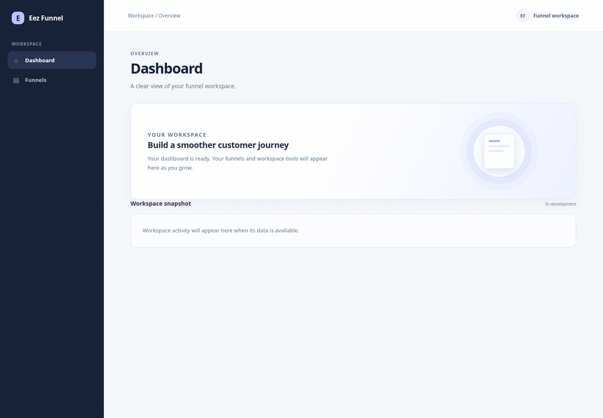

# Eez Funnel

An open source, single-owner funnel builder that you run on your own Cloudflare account. The v0.1.0 GitHub Release is published with CLI binaries for Linux, macOS, and Windows; it predates the typed editor described below. The application is still under development, and the release does not verify a Cloudflare production deployment. Cloudflare usage is billed under your account where applicable.

[](https://github.com/lianihossam-eng/EezFunnels/actions/workflows/ci.yml)
[](https://opensource.org/licenses/MIT)

## What you can do

- Create and manage funnels from five starter blueprints: tripwire, video sales letter, webinar, product launch, and lead generation.
- Build multi-page funnels: add steps, edit each page title and URL slug, connect pages with buttons, and preview at mobile, tablet, and desktop widths. See [Pages and steps](docs/pages.md) for the editor behavior.
- Edit typed sections, supported content blocks, actions, and theme settings in the dashboard.
- Upload PNG, JPEG, and WebP images to the R2-backed media library, add them to typed pages, and set meaningful or decorative alternative text. Uploaded images have public, content-addressed URLs; do not upload private images.
- Preview conversion of existing version 1 funnels before saving a typed revision. The editor reports unsupported content before conversion.
- Review revision history, save immutable revisions, and publish or unpublish them. Public V2 pages use `/f/:slug/:page_slug`; `/f/:slug` remains the entry page.
- Create and edit V2 forms in the typed editor, then capture submissions from published pages. See [Public forms](docs/forms.md) for current limits and data handling.
- Review retained submissions in the inbox and track follow-up as new, contacted, qualified, or closed.
- Review retained form completion counts by UTC date, stable form ID, and a closed campaign-channel category derived from `utm_medium` on the page containing the form. The report contains counts only; it does not track visits or calculate conversion rates.
- Review retained consent-based page and form interaction event counts by UTC date, event kind, and configured campaign ID. This aggregate report does not identify visitors or calculate conversion rates; see [Interaction measurement](docs/analytics.md).
- Use the native `eez` CLI to list, create, and publish funnels, retry an ambiguous mutation, or forward a Wrangler deploy command.
- Connect an MCP client to `/mcp` with a Worker Bearer secret. The server exposes `list_commands`, `execute_command`, `list_funnels`, and `get_funnel`.

The current release has no built-in user login or multi-user roles. It does not provide funnel JSON import/export, custom CSS or user-defined theme presets, a full CRM, unique-visitor analytics, full-funnel attribution, or AI generation. Optional consent-based page and form interaction events can be collected when configured; see [Interaction measurement](docs/analytics.md). See [Security](docs/security.md) before exposing an instance publicly.

## Scope

Eez Funnel is an open source funnel builder designed for self-hosted use on Cloudflare. The current release provides a single-owner dashboard without built-in accounts or multi-user roles.

## Demo

This animated capture shows the current dashboard, the webinar creation form, and its editor with the mobile preview selected. The sample content was created through the running local app.



## Quickstart

### Requirements

- Rust 1.85.0 with `rustfmt`, `clippy`, and the `wasm32-unknown-unknown` target. The checked-in `rust-toolchain.toml` pins these for the workspace.
- Node.js 22 or newer and npm. Wrangler is installed from the locked npm dependencies.
- A Cloudflare account is needed only for a remote deployment. Local development uses local D1/R2/KV bindings.

### Run locally

From the repository root:

```sh
npm ci
./scripts/install-worker-build.sh
npx wrangler d1 migrations apply DB --local --env dev
npm run dev -- --env dev
```

Open <http://localhost:8787>.  The Wrangler build command installs the pinned `wasm-bindgen` tool if it is missing. The separate `worker-build` CLI is installed by the script above; the application itself stays on Rust 1.85.0.

Run `cargo xtask check` for formatting, clippy, workspace tests, and layer validation. For the full local CI workflow, install the pinned audit tool with `./scripts/install-cargo-audit.sh`, then run `cargo xtask ci`.

See [Getting started](docs/getting-started.md) for CLI and local workflow details, and [Deploy](docs/deploy.md) before creating or changing remote Cloudflare resources.

## Architecture

The Rust Cloudflare Worker serves the Dioxus dashboard and the funnel API. D1 stores funnels, revisions, and command receipts; R2 and KV bindings are configured by the Worker. The dashboard assets are built into `apps/dashboard/dist`. Cloudflare production bindings and deployment remain unverified.

| Path | Current behavior |
|:---|:---|
| `/`, `/funnels`, `/funnels/:id` | Dashboard, funnel list, and editor |
| `/api/funnels` | List funnels or create a version 1 funnel |
| `/api/funnels/v2` | Create a typed version 2 funnel |
| `/api/funnels/:id` | Read or delete a funnel |
| `/api/funnels/:id/document` and `/revisions-v2` | Read a typed revision and its revision history |
| `/api/funnels/:id/edit-v2` and `/preview-v2` | Apply typed edits and preview a document |
| `/api/funnels/:id/convert-v2/preview` and `/convert-v2` | Preview and save a version 1 conversion |
| `/api/funnels/:id/stages-v2` and `/revisions-v2` | Upload and save a typed revision |
| `/api/funnels/:id/preview` | Preview proposed editor state |
| `/api/funnels/:id/revisions` | Save an editor revision |
| `/api/funnels/:id/publish` and `/unpublish` | Change the published revision pointer |
| `/api/v2/stage-capacity` | Read the configured staged-save capacity |
| `/api/media` | List and upload images in the R2-backed media library |
| `/media/:sha256` | Read a public, content-addressed image |
| `/f/:slug` | Render a published funnel |
| `/api/public/funnels/:slug/pages/:page_id/forms/:form_id/submissions` | Accept a public form submission after validating a supplied Origin |
| `/api/submissions` and `/api/submissions/:submission_id/status` | Read retained submissions and update their follow-up status |
| `/api/funnels/:funnel_id/completions?period=7|30|90` | Read retained form completion counts for one funnel |
| `/api/funnels/:funnel_id/interaction-report?period=7|30|90` | Read consented, retained interaction event aggregates for one funnel |
| `/funnels/:id/interaction-report` | View aggregate interaction counts for one funnel |
| `/mcp` | Stateless Streamable HTTP MCP endpoint |
| `/health` | Worker health response |

Commands, the native CLI, and MCP behavior are documented in [Commands](docs/commands.md), [Themes](docs/themes.md), and [MCP setup](docs/mcp.md). The architecture is summarized above.

## License

MIT. See [LICENSE](LICENSE).
