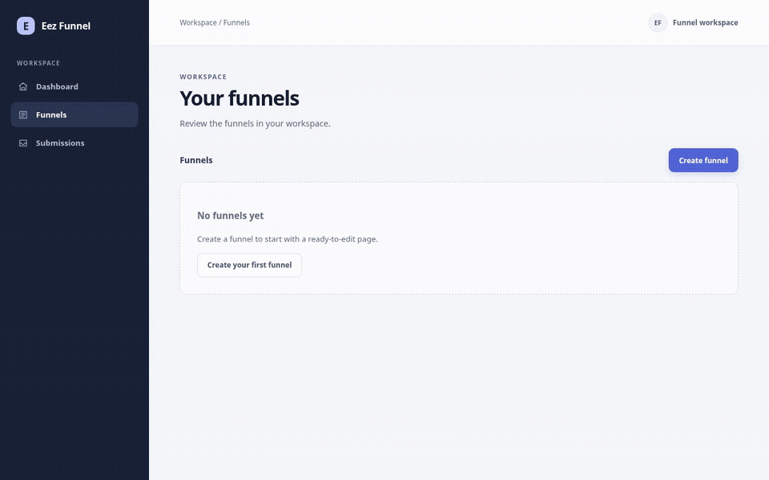
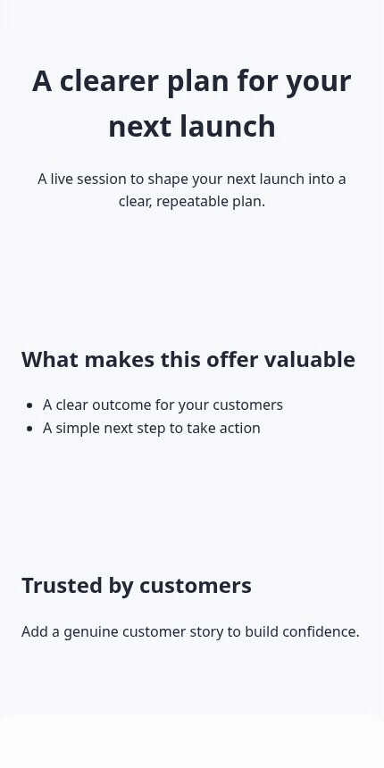

# Eez Funnel

An open-source, Rust-first funnel builder for single-owner deployments on your own Cloudflare Workers account. The current `main` branch supports typed multi-page editing, public forms, aggregate reports, SEO discovery, and mapped custom hosts. The published `v0.1.0` release contains CLI binaries for Linux, macOS, and Windows but predates the typed dashboard. Repository checks do not verify a production Cloudflare deployment. Cloudflare usage is billed under your account where applicable.

[](https://github.com/lianihossam-eng/EezFunnels/actions/workflows/ci.yml?query=branch%3Amain)
[](https://opensource.org/licenses/MIT)

## Demo

These recordings show the quote-request recipe being created, edited, saved, published, and viewed at mobile width. The sample uses fictional local copy and disposable data; it does not represent a production deployment or a real service result.





## What you can do

- Create and manage funnels from five starter blueprints: tripwire, video sales letter, webinar, product launch, and lead generation.
- Start a service funnel from a contact, estimate-request, or diagnostic-request recipe. Each creates a new document; later recipe changes do not alter existing funnels, and none promises a booking, price, diagnosis, or response date.
- Build multi-page funnels: add steps, edit each page title and URL slug, connect pages with buttons, and preview at mobile, tablet, and desktop widths. See [Pages and steps](docs/pages.md) for the editor behavior.
- Edit typed sections, supported content blocks, actions, and theme settings in the dashboard.
- Describe service offers with exact decimal prices, stated units and conditions, and reusable side-by-side comparisons. An announced total is entered explicitly; it is not calculated and no order is created.
- Add testimonials and case studies as contextualized evidence. Demonstrations are labeled, real claims carry attribution, date or period, scope, and limitations, and only existing media-library images can be attached.
- Upload PNG, JPEG, and WebP images to the R2-backed media library, add them to typed pages, and set meaningful or decorative alternative text. Uploaded images have public, content-addressed URLs; do not upload private images.
- Preview conversion of existing version 1 funnels before saving a typed revision. The editor reports unsupported content before conversion.
- Review revision history, save immutable revisions, and publish or unpublish them. Public V2 pages use `/f/:slug/:page_slug`; `/f/:slug` remains the entry page.
- Publish canonical links for public pages and serve a generated sitemap and crawler guidance using operator-configured HTTPS origins. Map custom hostnames from an operator-controlled Cloudflare zone to individual funnels. See [SEO and crawler guidance](docs/seo.md) and [Deploy](docs/deploy.md).
- Create French or English V2 forms, recover from public validation errors, and capture bounded, idempotent submissions. See [Public forms](docs/forms.md) for consent and data-handling details.
- Review retained submissions, export or erase one response, and track follow-up history and next actions in the private inbox.
- Configure an optional signed webhook for selected form fields. Delivery is disabled until the operator enables it; retries can result in zero, one, or multiple receiver deliveries, and a `2xx` confirms acceptance only.
- Review retained form completions and consented interactions, with registered campaign IDs and explicit collection, retention, and cohort coverage. Reports do not identify visitors or infer visitor-to-request, sales, or payment rates; see [Interaction measurement](docs/analytics.md).
- Use the native `eez` CLI to list, create, and publish funnels, retry an ambiguous mutation, or forward a Wrangler deploy command.
- Connect an MCP client to `/mcp` with a Worker Bearer secret. The server exposes `list_commands`, `execute_command`, `list_funnels`, and `get_funnel`.

## Scope and current limits

Eez Funnel is an open-source funnel builder designed for single-owner, self-hosted use on Cloudflare. The current application has no built-in user login or multi-user roles. The dashboard exports saved V2 funnels as versioned JSON templates and imports them as new unpublished drafts; templates contain the public document and media manifest, never briefs, submissions, or secrets. Missing images must be replaced with assets already in the target media library. The application does not provide custom CSS or user-defined theme presets, a full CRM, unique-visitor analytics, full-funnel attribution, or AI generation. Interaction events are optional, consent-based aggregate counts; see [Interaction measurement](docs/analytics.md). Read [Security](docs/security.md) before exposing an instance publicly. The [public edition contract](docs/public-edition.md) defines current behavior and boundaries; the [future pilot readiness guide](docs/runbooks/public-pilot-readiness.md) describes an operator rehearsal and rollback without claiming a remote deployment has occurred.

## Quickstart

### Requirements

- Rust 1.85.0 with `rustfmt`, `clippy`, and the `wasm32-unknown-unknown` target. The checked-in `rust-toolchain.toml` pins these for the workspace.
- Node.js 22 or newer and npm. Wrangler is installed from the locked npm dependencies.
- A Cloudflare account is needed only for a remote deployment. Local development uses local D1/R2/KV bindings.

### Run locally

From the repository root:

```sh
npm ci
./scripts/install-worker-build.sh
npx wrangler d1 migrations apply DB --local --env dev
npm run dev -- --env dev
```

Open <http://localhost:8787>.  The Wrangler build command installs the pinned `wasm-bindgen` tool if it is missing. The separate `worker-build` CLI is installed by the script above; the application itself stays on Rust 1.85.0.

Run `cargo xtask check` for formatting, clippy, workspace tests, and layer validation. For the full local CI workflow, install the pinned audit tool with `./scripts/install-cargo-audit.sh`, then run `cargo xtask ci`.

See [Getting started](docs/getting-started.md) for CLI and local workflow details, and [Deploy](docs/deploy.md) before creating or changing remote Cloudflare resources.

## Architecture

The Rust Cloudflare Worker serves the Dioxus dashboard and the funnel API. D1 stores funnels, revisions, and command receipts; R2 and KV bindings are configured by the Worker. The dashboard assets are built into `apps/dashboard/dist`. Cloudflare production bindings and deployment remain unverified. See [Architecture](docs/architecture.md) for layer ownership and the enforced dependency map.

| Path | Current behavior |
|:---|:---|
| `/`, `/funnels`, `/funnels/:id` | Dashboard, funnel list, and editor |
| `/api/funnels` | List funnels or create a version 1 funnel |
| `/api/funnels/v2` | Create a typed version 2 funnel |
| `/api/funnels/:id` | Read or delete a funnel |
| `/api/funnels/:id/document` and `/revisions-v2` | Read a typed revision and its revision history |
| `/api/funnels/:id/edit-v2` and `/preview-v2` | Apply typed edits and preview a document |
| `/api/funnels/:id/convert-v2/preview` and `/convert-v2` | Preview and save a version 1 conversion |
| `/api/funnels/:id/stages-v2` and `/revisions-v2` | Upload and save a typed revision |
| `/api/funnels/:id/preview` | Preview proposed editor state |
| `/api/funnels/:id/revisions` | Save an editor revision |
| `/api/funnels/:id/publish` and `/unpublish` | Change the published revision pointer |
| `/api/v2/stage-capacity` | Read the configured staged-save capacity |
| `/api/media` | List and upload images in the R2-backed media library |
| `/media/:sha256` | Read a public, content-addressed image |
| `/f/:slug` and `/f/:slug/:page_slug` | Render a published entry page and its V2 pages |
| Mapped custom funnel host `/` and `/:page_slug` | Render one mapped funnel; dashboard, owner APIs, and MCP are not available on that host |
| `/api/public/funnels/:slug/pages/:page_id/forms/:form_id/submissions` | Accept a public form submission after validating a supplied Origin |
| `/api/submissions` and `/api/submissions/:submission_id/status` | Read retained submissions and update status through the compatible legacy contract |
| `/api/submissions/:submission_id/follow-up` | Read private follow-up history or save a versioned disposition with an idempotency key |
| `/api/submissions/:submission_id/export` and `DELETE /api/submissions/:submission_id` | Export or erase one retained response; see the [erasure and recovery runbook](docs/runbooks/submission-erasure.md) |
| `/api/funnels/:funnel_id/completions?period=7|30|90` | Read retained form completion counts for one funnel |
| `/funnels/:id/completions` | View aggregate form completion counts for one funnel |
| `/api/funnels/:funnel_id/interaction-report?period=7|30|90` | Read consented, retained interaction event aggregates for one funnel |
| `/funnels/:id/interaction-report` | View aggregate interaction counts for one funnel |
| `/robots.txt` and `/sitemap.xml` | Provide crawler hints and list published, indexable pages only when a configured HTTPS origin is valid |
| `/mcp` | Stateless Streamable HTTP MCP endpoint |
| `/health` | Worker health response |

Commands, the native CLI, and MCP behavior are documented in [Commands](docs/commands.md), [Themes](docs/themes.md), and [MCP setup](docs/mcp.md). The architecture is summarized above.

See the [public edition contract](docs/public-edition.md) for current product boundaries, the [improvement series](docs/public-series.md) for delivery gates, and the [agent skill workflow](docs/skill-workflow.md) for contribution review and verification.

## License

MIT. See [LICENSE](LICENSE).
